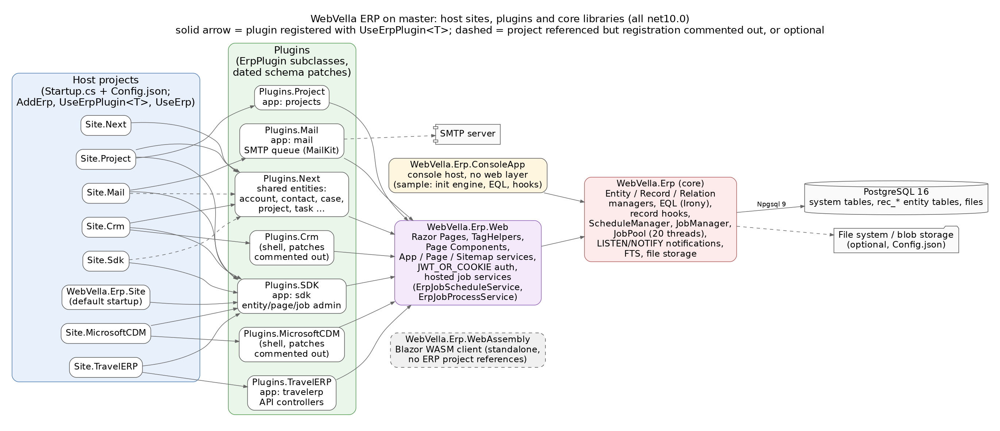

<!--{"sort_order":3, "name": "architecture", "label": "Architecture"}-->
# Architecture

This page describes how the projects in `WebVella.ERP3.sln` fit together on `master`. Every project targets `net10.0`.

The diagram source is [`docs/diagrams/architecture.dot`](../../diagrams/architecture.dot). After you change it, run [`docs/diagrams/render.sh`](../../diagrams/render.sh) (needs Graphviz) to regenerate `architecture.png` and `architecture.svg`.

## Layers

| Layer | Projects | What it does |
|-------|----------|--------------|
| Core | `WebVella.Erp` | Entity, record and relation managers over PostgreSQL (Npgsql 9). Also the EQL parser (Irony), record hooks, background jobs (`ScheduleManager`, `JobManager`, `JobPool`), LISTEN/NOTIFY notifications, full-text search and file storage. It has no web UI, but it references the `Microsoft.AspNetCore.App` shared framework, so the console host still needs the ASP.NET Core runtime. |
| Web | `WebVella.Erp.Web` | Razor Pages, tag helpers, page components, data sources, the app/page/sitemap services and the middleware. `AddErp()` registers `IErpService` and the two hosted job services (`ErpJobScheduleService`, `ErpJobProcessService`). `UseErp()` initializes the engine, system entities, the home page, background jobs and the plugins. |
| Plugins | `WebVella.Erp.Plugins.*` | Razor class libraries. Each defines a subclass of `ErpPlugin` and applies its schema through dated patch files (`<Plugin>.<yyyyMMdd>.cs`). Patches run when the plugin initializes, and only those newer than the plugin's stored version are applied. |
| Hosts | `WebVella.Erp.Site*`, `WebVella.Erp.ConsoleApp` | Executables that compose the layers. Each site has its own `Startup.cs` and `Config.json` and decides which plugins to register. |
| Client (separate) | `WebVella.Erp.WebAssembly` | A Blazor WebAssembly client. It does not reference the ERP projects. The solution only includes `Client`; `Server` and `Shared` sit beside it but are not in the solution. |

## Plugins

| Plugin | `Name` | What it adds |
|--------|--------|--------------|
| `WebVella.Erp.Plugins.SDK` | `sdk` | The **sdk** application: an admin UI for entities, relations, pages, data sources, users and roles, jobs, schedule plans, logs and code generation (`CodeGenService`). Also the "Clear job and error logs" job. |
| `WebVella.Erp.Plugins.Next` | `next` | Shared business entities used by the other plugins: `account`, `contact`, `address`, `case`, `project`, `task`, `milestone`, `comment`, `feed_item`, lookup lists and more. It creates no application. |
| `WebVella.Erp.Plugins.Project` | `project` | The **projects** application: pages, page components, data sources and hooks for the project, task and timelog records, plus the "Start tasks on start_date" job. Used together with Next. |
| `WebVella.Erp.Plugins.Mail` | `mail` | The **mail** application: SMTP services, an email queue and the "Process SMTP queue" job, which uses MailKit and runs every 10 minutes. |
| `WebVella.Erp.Plugins.Crm` | `crm` | A placeholder. Its patch is commented out, so it adds no entities or application yet. |
| `WebVella.Erp.Plugins.MicrosoftCDM` | `MicrosoftCDMPlugin` | A placeholder for Microsoft Common Data Model entities. Its patch is commented out. |
| `WebVella.Erp.Plugins.TravelERP` | `travelerp` | The **travelerp** application: missions, travel requests, claims, budgets, invoices, payments and approvals (`tims_*` entities), with record hooks and REST controllers. See its [README](../../../WebVella.Erp.Plugins.TravelERP/README.md). |

## Host projects

| Host | Registers (`UseErpPlugin<T>`) |
|------|-------------------------------|
| `WebVella.Erp.Site` (default startup project) | SDK |
| `WebVella.Erp.Site.Sdk` | SDK (the Next registration is commented out) |
| `WebVella.Erp.Site.Next` | Next |
| `WebVella.Erp.Site.Project` | Next, SDK, Project |
| `WebVella.Erp.Site.Crm` | Next, SDK, Crm |
| `WebVella.Erp.Site.Mail` | SDK, Mail (the Next registration is commented out) |
| `WebVella.Erp.Site.MicrosoftCDM` | MicrosoftCDM, SDK |
| `WebVella.Erp.Site.TravelERP` | SDK, TravelERP |
| `WebVella.Erp.ConsoleApp` | None. It shows how to use the core without a web host: it initializes the engine from `Config.json`, runs EQL and registers record hooks. |

## Startup sequence (web sites)

1. `ConfigureServices` loads `config.json`, configures MVC and Razor Pages with Newtonsoft JSON, and sets up the `JWT_OR_COOKIE` policy scheme: requests with a bearer token use JWT, all others use the `erp_auth_base` cookie. It then calls `services.AddErp()`.
2. `Configure` sets up localization, compression, CORS, static files, routing and authentication. It then calls `UseErpPlugin<T>()` once per plugin, then `UseErp()`, `UseErpMiddleware()` and `UseJwtMiddleware()`.
3. `UseErp()` reads the settings, opens a `DbContext` and sets up AutoMapper, including each plugin's mappings. It then creates the system entities, makes sure a home page exists and registers the `[Job]` types it finds. Last, it calls `Initialize` on each registered plugin, which runs that plugin's patches and creates its schedule plans.

## Data and runtime services

- **Storage**: system metadata, entity records (`rec_<entity>` tables) and files live in one PostgreSQL database, set by `Settings:ConnectionString`. Set `EnableFileSystemStorage` or `EnableCloudBlobStorage` to store file contents outside the database.
- **Background jobs**: see [Background jobs](../background-jobs/overview.md). They are on unless `Settings:EnableBackgroundJobs` (or the legacy `EnableBackgroungJobs`) is `false`. The committed configs turn them off for `WebVella.Erp.Site`, `Site.Sdk` and the ConsoleApp, and on for the other sites.
- **Notifications**: `NotificationContext` uses PostgreSQL `LISTEN`/`NOTIFY` to send record-change notifications between processes.

## Who wrote it

The code is from WebVella's maintainers. By commit count, the core, web and SDK layers are by Boz (Bozhidar) Zashev and Rumen Yankov, and they also wrote ConsoleApp, Crm, Mail, MicrosoftCDM and WebAssembly (2019-2026). `WebVella.Erp.Plugins.TravelERP` and `WebVella.Erp.Site.TravelERP` came later (May 2026). Patrick Bradley added them as TIMS, and a Devin AI commit renamed them to TravelERP.
